<!-- ============================================================
  README de perfil de GitHub (versión visual).
  Necesita en la raíz del repositorio: header.svg y divider.svg.
  Los comentarios "VERIFICA" no se ven en la página: confirma que
  esos datos son ciertos y que puedes defenderlos en una entrevista.
  La sección de proyectos está comentada: descoméntala al rellenarla.
============================================================ -->

  

  

## 👋 Sobre mí

Desarrollador backend junior, apasionado por las arquitecturas sólidas, las APIs bien diseñadas y los sistemas escalables. Busco un equipo donde aprender de perfiles con más experiencia, trabajar en proyectos reales y crecer.

| | |
|---|---|
| 🎓 **Formación** | Técnico Superior en DAM · Ingeniería Informática (UMU) · Especialización en IA & Big Data <!-- VERIFICA: título y estado de cada estudio --> |
| 💼 **Experiencia** | Un año en desarrollo backend <!-- VERIFICA: cuánto fue prácticas y cuánto trabajo; sé preciso --> |
| 🎯 **Busco** | Oportunidades como desarrollador backend · Software Developert |
| 📚 **Me interesa** | Arquitectura de software, optimización de rendimiento, procesamiento de datos e IA aplicada |
| 🗣️ **Idiomas** | Español · Inglés <!-- VERIFICA: añade tu nivel de inglés (por ejemplo B2) --> |
| ⚡ **Dato curioso** | El código limpio y la mejora continua son mi rutina, en la pantalla y en el gimnasio 🏋️‍♂️ |

## 🛠️ Stack

**💻 Lenguajes**

**⚙️ Backend y bases de datos**

**🚢 DevOps y cloud**

**🧰 Herramientas**

**🌱 Aprendiendo**

<!-- ============================================================
## 🚀 Proyectos destacados

Con dos o tres bien explicados basta: qué hace, con qué tecnologías
y cómo ejecutarlo. Enlaza cada uno a su repositorio.

| Proyecto | Descripción | Tecnologías |
|---|---|---|
| [Nombre](https://github.com/javimendz/repo) | Qué problema resuelve, en una línea | Java, Spring Boot, PostgreSQL, Docker |
| [Nombre](https://github.com/javimendz/repo) | Qué problema resuelve, en una línea | Go, PostgreSQL |
| [Nombre](https://github.com/javimendz/repo) | Qué problema resuelve, en una línea | Python, pandas |
============================================================ -->

## 📊 Actividad en GitHub

 

  

## 🌍 In English

Junior backend developer with a background in multiplatform application development (DAM), computer engineering (UMU) and a specialization in AI and Big Data. I work with Java (Spring Boot), TypeScript (NestJS), Python and C#, and I am currently learning Go. I am looking for my next backend role.

### 🤝 Conecta conmigo

¿Tienes un proyecto o una oferta backend? Escríbeme por [LinkedIn](https://www.linkedin.com/in/javiermendz/) o a [javiermendez.dev00@gmail.com](mailto:javiermendez.dev00@gmail.com).

